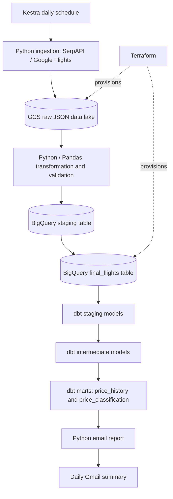
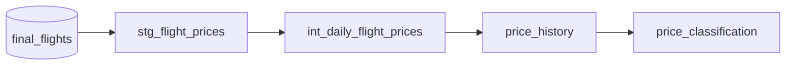

# UK–Mauritius Flight Price Pipeline

**An end-to-end data engineering project that tracks return-flight prices from five UK airports to Mauritius, builds a daily price history in BigQuery, classifies the cheapest observed fare, and emails a daily summary.**

The pipeline uses **SerpAPI (Google Flights)** for extraction, **Google Cloud Storage (GCS)** as a raw data lake, **Python/Pandas** for transformation, **BigQuery** for warehousing, **dbt** for analytics models and tests, and **Kestra** for orchestration. Infrastructure is managed with **Terraform**.

> **Project status:** Version 1 is implemented and has completed a successful end-to-end Kestra execution, including email delivery. Daily unattended runs depend on the local Docker/Kestra host remaining online.

## Contents

- [Project overview](#project-overview)
- [Architecture](#architecture)
- [Technology stack](#technology-stack)
- [Data and modelling](#data-and-modelling)
- [Repository structure](#repository-structure)
- [Prerequisites](#prerequisites)
- [Configuration and setup](#configuration-and-setup)
- [Run the pipeline manually](#run-the-pipeline-manually)
- [Kestra orchestration](#kestra-orchestration)
- [Daily email report](#daily-email-report)
- [Data quality and reliability](#data-quality-and-reliability)
- [Costs and limitations](#costs-and-limitations)
- [Roadmap](#roadmap)

## Project overview

Airfares change over time, making it difficult to know whether a particular quote is unusually expensive or represents good value. This project creates a reproducible history of observed fares for a fixed itinerary and uses that history to support a simple daily decision: **what is the cheapest price available today, and how does it compare with previous observations?**

**Search parameters used in v1**

| Parameter | Value |
| --- | --- |
| Departure airports | London Heathrow (`LHR`), London Gatwick (`LGW`), Manchester (`MAN`), Birmingham (`BHX`), London Stansted (`STN`) |
| Destination | Mauritius (`MRU`) |
| Outbound date | 7 January 2027 |
| Return date | 16 January 2027 |
| Travellers | 2 adults |
| Cabin | Economy (`travel_class=1`) |
| Currency | GBP |
| Search market and language | UK (`gl=uk`), English (`hl=en`) |
| Extraction frequency | Intended daily, at 12:00 Europe/London |

The project records **observed API responses**, not historical ticket sales or guaranteed bookable fares. Prices may change before a booking is made.

## Architecture



The core Kestra flow executes four stages sequentially:

1. **`ingest_flight_prices`** — calls SerpAPI for each configured departure airport and stores the raw responses in GCS.
2. **`load_bigquery`** — reads raw files from GCS, transforms and validates flight records, loads a staging table and merges them into the final warehouse table.
3. **`run_dbt`** — runs `dbt build` to refresh analytics models and execute their tests.
4. **`email_price_report`** — queries the latest classified cheapest fare and emails the result.

Kestra advances to the next stage only when the preceding task completes successfully. A Python process must return a **non-zero exit code** for Kestra to recognise its failure.

### Raw data layout

Responses are stored in GCS with an extraction-date partition-like folder structure:

```text
gs://flights-pipeline-data-lake-ya/
└── raw/flights/
    └── extraction_date=YYYY-MM-DD/
        ├── LHR_MRU_<timestamp>.json
        ├── LGW_MRU_<timestamp>.json
        ├── MAN_MRU_<timestamp>.json
        ├── BHX_MRU_<timestamp>.json
        └── STN_MRU_<timestamp>.json
```

The timestamped filenames preserve the raw responses for audit and reprocessing. This is a **logical folder convention**, not a native BigQuery partition.

## Technology stack

| Layer | Technology | Role |
| --- | --- | --- |
| Data source | SerpAPI — Google Flights | Flight search results and prices |
| Ingestion | Python | Parameterised API calls and JSON uploads |
| Raw storage | Google Cloud Storage | Retains source responses |
| Processing | Python, Pandas | Normalisation, validation and deterministic IDs |
| Data warehouse | Google BigQuery | Staging and curated flight observations |
| Analytics | dbt 2.0.9 | SQL transformations, marts and tests |
| Orchestration | Kestra with Docker and PostgreSQL | Task execution, scheduling and logs |
| Reporting | Python, BigQuery client, Gmail SMTP | Daily email with the cheapest observed fare |
| Infrastructure | Terraform | GCS bucket and BigQuery dataset |
| Environment management | `uv`, Python 3.13 | Reproducible Python dependencies |

The Google Cloud project used by this implementation is `flights-pipeline-510915`, with its BigQuery dataset in `europe-west2`.

## Data and modelling

### Python transformation

The BigQuery loader calls `transform_flights()` from `transform.py`. The transformation extracts itineraries from the SerpAPI JSON, normalises relevant fields, calculates stop counts, retains flight-leg information and generates an `observation_id` for each record.

The deterministic ID is derived from core itinerary fields, including the observation/extraction date and flight details. The loader uses a BigQuery **staging + `MERGE`** pattern to avoid inserting the same observation ID repeatedly into `final_flights`.

Selected warehouse fields include:

| Field | Meaning |
| --- | --- |
| `observation_id` | Deterministic identifier for a recorded itinerary |
| `extraction_date` | Date on which the fare was observed |
| `departure_airport`, `arrival_airport` | IATA airport codes |
| `outbound_date`, `return_date` | Travel dates requested |
| `price`, `currency` | Quoted price and currency |
| `total_duration`, `stops` | Itinerary duration and stop count |
| `flights` | Flight-leg information retained as JSON/string data |
| `source_file` | Originating GCS object |

Rows with missing required values are validated during transformation. In particular, missing prices are excluded rather than treated as valid fares. Some airports may return no eligible itineraries on a given extraction; empty results need to be handled without falsely reporting a price.

### dbt model layers

The models read from the BigQuery source table `flights_warehouse.final_flights`:



- **`stg_flight_prices`** — cleaning, casting and consistent field names for downstream SQL.
- **`int_daily_flight_prices`** — daily price aggregation, including minimum, maximum and average observed fares.
- **`price_history`** — the daily cheapest observed fare and related historical comparisons.
- **`price_classification`** — classifies **one cheapest fare overall per extraction date**, across all configured UK airports; it is **not** a per-airport price table.

Price classifications used in the project include **Below Average**, **Average**, **Above Average** and **Insufficient History**. The exact thresholds and logic are defined in the dbt model SQL and should be reviewed there rather than inferred from the label alone.

The dbt project includes data quality tests such as `not_null`, `unique` and `accepted_values`. Running `dbt build` executes the models and their associated tests.

Example query to inspect the most recent daily results:

```sql
SELECT
    extraction_date,
    min_price_gbp,
    price_category
FROM `flights-pipeline-510915.flights_warehouse.price_classification`
ORDER BY extraction_date DESC
LIMIT 10;
```

## Repository structure

The structure below shows the main source-controlled components. Generated files, local virtual environments and credentials are intentionally omitted.

```text
flight_prices/
├── src/
│   └── flight_prices/
│       ├── ingestion_gcs.py       # SerpAPI → GCS
│       ├── bq_loader.py           # GCS → BigQuery
│       ├── transform.py           # Normalisation and validation
│       └── email_report.py        # Daily cheapest-fare email
├── dbt_env/
│   ├── pyproject.toml
│   ├── uv.lock
│   └── flight_prices_dbt/
│       ├── dbt_project.yml
│       ├── models/
│       │   ├── staging/
│       │   ├── intermediate/
│       │   └── marts/
│       └── ...
├── orchestration/
│   ├── docker-compose.yml
│   └── flows/
│       └── flight_price_pipeline.yml  # Export the tested Kestra flow here
├── terraform/
│   ├── main.tf
│   └── variables.tf
├── pyproject.toml
├── uv.lock
├── .gitignore
└── README.md
```

> The Kestra flow can be authored in the Kestra UI; export or copy the tested YAML into `orchestration/flows/flight_price_pipeline.yml` so the orchestration configuration is version-controlled.

## Prerequisites

- Python **3.13** and [`uv`](https://docs.astral.sh/uv/).
- Docker Desktop (or a compatible Docker engine) and Docker Compose.
- Google Cloud account and a project with billing configured as appropriate.
- Google Cloud CLI (`gcloud`) and permissions for the GCS bucket and BigQuery dataset.
- SerpAPI account with Google Flights API access and sufficient request quota.
- Gmail account with two-step verification and an **App Password** for SMTP reporting.
- Terraform, **only if provisioning infrastructure yourself**.

This v1 setup runs Kestra locally and uses Docker bind mounts. It is not a fully hosted, always-on deployment.

## Configuration and setup

### 1. Clone the repository and install dependencies

```bash
git clone <YOUR_REPOSITORY_URL>
cd flight_prices

# Pipeline Python environment
uv sync --frozen --python 3.13

# Separate dbt CLI environment
uv sync --project dbt_env --frozen --python 3.13
```

The root project and `dbt_env/` have separate `pyproject.toml` and `uv.lock` files. dbt **2.0.9** must be declared in `dbt_env/pyproject.toml`; it should not depend on a globally installed executable.

### 2. Configure environment variables

Create a `.env` file in the repository root (never commit it):

```dotenv
# Flight API
SERPAPI_API_KEY=replace_with_your_serpapi_key

# Kestra / PostgreSQL
KESTRA_DB_PASSWORD=replace_with_a_strong_database_password
KESTRA_AUTH_PASSWORD=replace_with_a_strong_kestra_password

# Email (Gmail App Password, not the normal account password)
EMAIL_FROM=sender@gmail.com
EMAIL_TO=recipient@gmail.com
GMAIL_APP_PASSWORD=replace_with_your_gmail_app_password
```

These are the variables used by the current pipeline and local Kestra setup. Supply any additional values required by your own script/configuration versions. Avoid echoing secrets in logs.

### 3. Authenticate to Google Cloud

For **local development**, authenticate using Application Default Credentials (ADC):

```bash
gcloud auth application-default login
```

The ADC file is normally located at:

```text
~/.config/gcloud/application_default_credentials.json
```

The Docker-based Kestra tasks mount this credentials file read-only and set:

```bash
GOOGLE_APPLICATION_CREDENTIALS=/tmp/gcp-adc.json
GOOGLE_CLOUD_PROJECT=flights-pipeline-510915
```

**Important:** A successful token refresh establishes authentication, but not necessarily permission for every GCS/BigQuery operation. Test the relevant read/write operations with the intended credentials. For deployment, use a dedicated, least-privilege service identity rather than a personal ADC file.

### 4. Provision infrastructure (optional)

If you are deploying into a new Google Cloud project, inspect and configure the Terraform variables before applying:

```bash
cd terraform
terraform init
terraform plan
terraform apply
cd ..
```

The existing project provisions a GCS data-lake bucket and a BigQuery warehouse dataset. Review the Terraform configuration and cloud billing implications before running `apply`. Do not commit Terraform state files containing sensitive information.

### 5. Set up dbt credentials

The dbt project uses a local profile file, normally `~/.dbt/profiles.yml`, and connects to BigQuery in `europe-west2`. Configure a profile that matches the `profile:` name in `dbt_project.yml` (in this project, `flight_prices_dbt`).

In Kestra, the profile directory is mounted read-only into the task container. The workflow also provides Google ADC credentials and an explicit project ID. Authentication settings in `profiles.yml` must be compatible with that container environment.

## Run the pipeline manually

Commands below are run from the repository root. They are useful for development and debugging; ingestion makes real SerpAPI requests.

### 1. Fetch raw flight data

```bash
uv run --env-file .env python src/flight_prices/ingestion_gcs.py \
  --engine google_flights \
  --arrival_id MRU \
  --outbound_date 2027-01-07 \
  --return_date 2027-01-16 \
  --currency GBP \
  --gl uk \
  --hl en \
  --travel_class 1 \
  --adults 2 \
  --gcs_bucket flights-pipeline-data-lake-ya
```

### 2. Load observations into BigQuery

```bash
uv run --env-file .env python src/flight_prices/bq_loader.py
```

The loader processes GCS responses, uses `transform.py`, loads staging and merges the records into `final_flights`. Confirm its configured extraction-date scope before manually running it against a large history.

### 3. Build dbt models and run tests

```bash
uv run --project dbt_env --frozen --python 3.13 \
  dbt build \
  --project-dir dbt_env/flight_prices_dbt \
  --profiles-dir "$HOME/.dbt"
```

### 4. Send the email report

```bash
uv run --env-file .env python src/flight_prices/email_report.py
```

This sends a **real email**, and the script expects a price-classification row for the current date in **Europe/London**. Test an older day's data separately when appropriate; do not silently fall back to stale data.

## Kestra orchestration

Kestra runs with a PostgreSQL metadata database using `orchestration/docker-compose.yml`.

From the repository root:

```bash
docker compose --env-file .env -f orchestration/docker-compose.yml up -d
```

Open [http://localhost:8080](http://localhost:8080) and import/save the YAML from `orchestration/flows/flight_price_pipeline.yml`.

**Local bind-mount configuration:** Kestra's Docker task runner must be configured to allow volume mounts. The flow's paths must be changed to the actual location of the repository and Google credentials on **your** machine. For example, `/Users/<YOUR_USERNAME>/flight_prices` is a placeholder, not a portable container path. The `docker.sock` mount provides significant host control; use this configuration only in a trusted local development environment.

Each Kestra task uses a Python 3.13 image with `uv` and mounts the required source files and credentials. The dbt stage runs from the separate `dbt_env` dependency project and uses a writable temporary copy of the dbt project so compiled artifacts can be created.

### Daily schedule

To execute at **12:00 noon UK time**:

```yaml
triggers:
  - id: daily_flight_prices
    type: io.kestra.plugin.core.trigger.Schedule
    cron: "0 12 * * *"
    timezone: Europe/London
    recoverMissedSchedules: NONE
```

> **Cron note:** `1 2 * * *` means **02:01 AM**, not noon. Use `0 12 * * *` for 12:00 PM.

The `Europe/London` timezone accounts for GMT/BST changes. `recoverMissedSchedules: NONE` is intended to prevent catch-up executions after downtime. The laptop, Docker daemon and Kestra must be running when the schedule fires; this v1 design is **not guaranteed to run while the computer is asleep or offline**.

To stop the local services without deleting their named volumes:

```bash
docker compose --env-file .env -f orchestration/docker-compose.yml down
```

Avoid `down -v` unless you deliberately want to delete Kestra/PostgreSQL persistent volumes.

### Testing without extra API calls

If ingestion and BigQuery loading have succeeded but dbt or email fails, rerun or test **only the failed downstream task**, where supported by the Kestra UI. Do not start a brand-new full execution just to debug dbt; doing so can consume more SerpAPI quota and write another snapshot.

## Daily email report

The report uses the `price_classification` mart and sends **one cheapest observed fare overall for the day**, not a five-airport ranking. It includes:

- The observation date and configured travel dates.
- The cheapest price in GBP.
- The price classification relative to the model's historical comparison.
- The departure airport **if that field is available in the mart**.

The report is sent using Gmail SMTP with an App Password. It runs **after** `dbt build` succeeds and fails rather than presenting an older observation as today's result.

## Data quality and reliability

- **Raw retention:** Raw SerpAPI responses remain in GCS for inspection and potential reprocessing.
- **Validation:** Transformation checks required fields and omits unusable price records.
- **Deterministic identifiers:** `observation_id` supports duplicate-safe merges of equivalent observations.
- **Warehouse upsert:** Staging-to-final `MERGE` prevents duplicate IDs in the final table when reprocessing.
- **dbt tests:** Model/schema checks include `not_null`, `unique` and `accepted_values`.
- **Orchestration dependencies:** Kestra halts downstream execution when a task exits with failure.
- **Date-aware reporting:** The email only reports data for the current UK extraction date.

**Important caveat:** Multiple API runs on the same date may produce different fares and therefore different observations. An idempotent BigQuery merge does not mean that repeated extractions are identical. Successful task completion also does not automatically guarantee completeness across all five airports; production-grade monitoring should explicitly validate expected airport coverage.

## Costs and limitations

- **API usage:** Every real ingestion may consume multiple SerpAPI requests; check the account's quota and pricing.
- **Google Cloud:** GCS storage/operations and BigQuery storage/queries may incur charges. Cost-free operation is **not guaranteed**; monitor billing and budget alerts.
- **Local scheduling:** Kestra will not reliably execute scheduled tasks while the host is shut down, asleep or Docker is stopped.
- **Credentials:** Personal ADC and root-project `.env` mounts are convenient for local development, but are not appropriate for a public or multi-user deployment.
- **Scope:** v1 tracks a single set of travel dates, two adults, economy class and five departure airports.
- **Price interpretation:** Observed fares are time-sensitive, subject to API availability and fare changes, and are not booking guarantees.
- **Operational efficiency:** The current Docker execution can rebuild fresh Python environments on each run, increasing startup time and downloads.

### Security checklist

Add at least the following to `.gitignore`:

```gitignore
.env
.env.*
!.env.example
.venv/
**/.venv/
__pycache__/
*.py[cod]
*.log
.dbt/
**/target/
**/logs/
.terraform/
*.tfstate
*.tfstate.*
*.tfvars
*.tfvars.json
*.json-key
*service-account*.json
```

Inspect changes before pushing: do not commit Gmail App Passwords, SerpAPI keys, ADC files, service-account keys or sensitive Terraform state. If a credential is ever committed, revoke/rotate it rather than only removing the file from the latest commit.

## Roadmap

### v1 — Implemented

- [x] Parameterised flight-price ingestion from SerpAPI.
- [x] Raw JSON storage in GCS.
- [x] Python transformation and BigQuery staging/merge.
- [x] dbt staging, intermediate, price-history and classification models.
- [x] dbt model tests.
- [x] Kestra task orchestration.
- [x] Daily cheapest-fare email report.
- [x] Daily schedule configured (verify the cron expression is `0 12 * * *` if noon is intended).
- [ ] Confirm a fully unattended scheduled execution on the local host.

### v2 — Planned improvements

- **Cloud-native ELT:** Land raw data in BigQuery first and perform more transformation within BigQuery/dbt, reducing local Pandas processing.
- **Always-on execution:** Host orchestration or scheduling in a managed environment rather than relying on a laptop.
- **Least-privilege authentication:** Replace personal credential mounts with a workload/service identity and managed secrets.
- **Container optimisation:** Build versioned images with the dependencies preinstalled.
- **Monitoring:** Add failure alerts, freshness checks, expected-airport coverage and API-quota monitoring.
- **Expanded analytics:** Daily price changes, long-term trends and optional airport-level comparisons or a dashboard.
- **Tests and CI:** Add Python unit tests, formatting/linting and automated dbt validation.

---

**Purpose:** A practical data engineering portfolio project demonstrating API ingestion, cloud storage, warehouse loading, SQL analytics, orchestration and automated reporting using a real personal use case.
